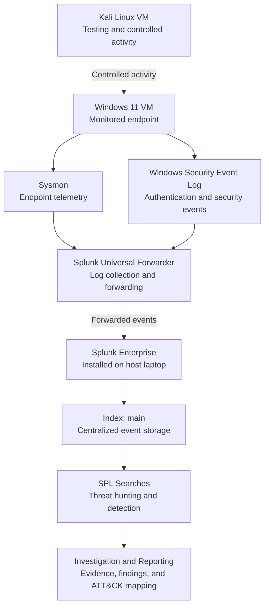

# SOC Detection & Monitoring Lab

A hands-on Security Operations Center (SOC) detection engineering project using **Splunk Enterprise, Windows 11, Sysmon, Splunk Universal Forwarder, and Kali Linux**. This lab demonstrates how endpoint telemetry can be collected, analyzed, investigated, and mapped to MITRE ATT&CK through practical security monitoring exercises.

> **Project focus:** SIEM monitoring, Windows event analysis, threat hunting, SPL detection development, attack simulation, and incident documentation.

---

## Table of Contents

* [Project Overview](#project-overview)
* [Objectives](#project-objectives)
* [Lab Architecture](#lab-architecture)
* [Data Pipeline](#data-pipeline)
* [Lab Components](#lab-components)
* [Repository Navigation](#repository-navigation)
* [Detection Modules and Validation Status](#detection-modules-and-validation-status)
* [Detection Development Workflow](#detection-development-workflow)
* [Validation Methodology](#validation-methodology)
* [Skills Demonstrated](#skills-demonstrated)
* [Security and Privacy](#security-and-privacy)

---

## Project Overview

This project builds a small SOC monitoring environment to explore how security events generated on a Windows endpoint can be forwarded to a SIEM and investigated using Splunk Search Processing Language (SPL).

Kali Linux is used as a testing environment to generate controlled activity. Windows 11 generates endpoint and authentication telemetry, while Splunk Enterprise provides centralized searching and analysis.

The project focuses on understanding the complete defensive workflow:

1. Generate controlled activity.
2. Collect endpoint telemetry.
3. Forward events to Splunk.
4. Search and analyze the indexed events.
5. Develop and validate detection queries.
6. Investigate findings and document evidence.
7. Map relevant behavior to MITRE ATT&CK.

This is a learning and portfolio project. Detection rules are not considered production-ready solely because a query returns events.

## Project Objectives

* Configure a Windows endpoint for security monitoring.
* Collect process creation and Windows authentication events.
* Use Sysmon to improve visibility into endpoint activity.
* Forward Windows telemetry using Splunk Universal Forwarder.
* Search, filter, and analyze events using SPL.
* Develop detection and threat-hunting queries.
* Investigate simulated security activity.
* Document detection logic, limitations, and findings.
* Map observed behavior to relevant MITRE ATT&CK techniques.
* Maintain reproducible evidence through screenshots and documentation.

---

## Lab Architecture

The lab separates the testing environment, monitored endpoint, and SIEM platform.



### Architecture notes

* **Kali Linux:** Used to perform controlled testing and generate observable activity.
* **Windows 11:** The monitored endpoint where process and security events are generated.
* **Sysmon:** Provides detailed endpoint telemetry, including process creation and other configured event types.
* **Windows Security Event Log:** Provides authentication and other Windows security events.
* **Splunk Universal Forwarder:** Collects configured Windows events and forwards them to Splunk Enterprise.
* **Splunk Enterprise:** Runs on the physical host laptop and provides search and analysis capabilities.
* **Splunk index `main`:** Stores the events used by the lab's searches.
* **SPL and documentation:** Support threat hunting, detection development, investigation, and reporting.

The diagram represents the intended data flow. It does not imply that every telemetry source or detection has been fully validated.

---

## Data Pipeline

The data pipeline describes how activity on the monitored endpoint becomes searchable evidence in Splunk.

### 1. Activity generation

Controlled activity is generated during lab exercises. Kali Linux can be used for network testing, while commands executed on the Windows endpoint can generate process and authentication events.

The resulting telemetry depends on the activity performed and the logging configuration.

### 2. Endpoint event generation

Windows records operating system and security activity.

The lab uses two important sources:

| Data source            | Purpose                              | Example                                                      |
| ---------------------- | ------------------------------------ | ------------------------------------------------------------ |
| Sysmon Operational log | Detailed endpoint activity           | Process creation, Event ID 1                                 |
| Windows Security log   | Authentication and security activity | Successful logon, Event ID 4624; failed logon, Event ID 4625 |

Not every action generates every event type. Event availability depends on the action, Windows configuration, Sysmon configuration, and applicable audit policies.

### 3. Event collection

Splunk Universal Forwarder runs on the Windows 11 VM and collects the event logs configured in its inputs.

The relevant inputs include the Sysmon Operational channel and the Windows Security log.

The forwarder must have the required permissions to read each configured channel. A configuration entry alone does not prove that collection is working.

### 4. Event forwarding

The Universal Forwarder sends collected events to the Splunk Enterprise receiving endpoint.

The receiving connection and port must be configured correctly on both sides. A successful network connection is useful evidence, but it does not by itself prove that all required events are being indexed.

### 5. Indexing and searching

Splunk Enterprise receives the forwarded data and indexes it in `main`, as configured for the lab.

Example search to verify Sysmon process-creation events:

```spl
index=main source="WinEventLog:Microsoft-Windows-Sysmon/Operational" EventCode=1
| table _time host ComputerName User ParentImage Image CommandLine
| sort - _time
```

Example search to verify Windows failed-logon events:

```spl
index=main source="WinEventLog:Security" EventCode=4625
| table _time host ComputerName TargetUserName LogonType
| sort - _time
```

Field availability can vary with event format and field extraction. If a field is empty, inspect the raw event and adjust the search to match the fields actually present in your data.

### 6. Detection and threat hunting

SPL queries are used to search for relevant event patterns, suspicious command lines, authentication failures, and other behaviors.

A broad hunting query can help establish visibility. A focused detection should additionally demonstrate that the intended behavior matches while relevant benign activity does not produce unacceptable false positives.

### 7. Investigation and reporting

Results are reviewed in context. Findings are documented with the relevant evidence, observed behavior, potential false positives, limitations, and appropriate MITRE ATT&CK mappings.

**Pipeline summary:**

`Controlled Activity → Windows Events → Sysmon / Security Logs → Universal Forwarder → Splunk Enterprise → Index → SPL Searches → Investigation`

---

## Lab Components

| Component                  | Role                                          |
| -------------------------- | --------------------------------------------- |
| Kali Linux VM              | Testing and controlled activity generation    |
| Windows 11 VM              | Monitored endpoint                            |
| Sysmon                     | Endpoint telemetry collection                 |
| Windows Security Event Log | Authentication and security telemetry         |
| Splunk Universal Forwarder | Event collection and forwarding               |
| Splunk Enterprise          | Centralized search and analysis               |
| SPL                        | Hunting and detection logic                   |
| MITRE ATT&CK               | Adversary behavior classification and mapping |
| GitHub                     | Version control and project documentation     |

### Environment details

* **SIEM:** Splunk Enterprise
* **Endpoint operating system:** Windows 11
* **Endpoint telemetry:** Sysmon and Windows Security logs
* **Forwarding agent:** Splunk Universal Forwarder
* **Testing environment:** Kali Linux
* **Index used in lab searches:** `main`

---

## Repository Navigation

The repository is organized so that reviewers can move from a simulated activity to its detection logic, supporting queries, investigation notes, and evidence.

| Directory                                  | Purpose                                                    |
| ------------------------------------------ | ---------------------------------------------------------- |
| [`Architecture/`](Architecture/)           | Lab architecture and environment documentation             |
| [`Attack-Simulation/`](Attack-Simulation/) | Procedures and notes describing controlled test activity   |
| [`Detection-Rules/`](Detection-Rules/)     | Detection objectives, logic, and rule documentation        |
| [`Incident-Reports/`](Incident-Reports/)   | Investigation findings and incident-style reports          |
| [`MITRE-Mapping/`](MITRE-Mapping/)         | Relevant MITRE ATT&CK technique mappings                   |
| [`SPL-Queries/`](SPL-Queries/)             | SPL searches used for hunting and detection                |
| [`Screenshots/`](Screenshots/)             | Visual evidence of commands, events, searches, and results |

### Suggested review path

If you are reviewing this project for the first time:

1. Start with `Architecture/` to understand the environment.
2. Open an exercise in `Attack-Simulation/` to understand the activity being tested.
3. Review the corresponding query in `SPL-Queries/`.
4. Compare the query with its documentation in `Detection-Rules/`.
5. Inspect the supporting evidence in `Screenshots/`.
6. Read the associated report in `Incident-Reports/`.
7. Review the relevant technique and mapping rationale in `MITRE-Mapping/`.

Directory names are linked above. Individual files should be opened from their respective directories; file names may vary between modules.

---

## Detection Modules and Validation Status

The table below summarizes the detection exercises developed during this project. Status labels distinguish observed telemetry from validated detection behavior.

| Module | Detection area                         | Primary telemetry                                 | Validation status                                                                             |
| ------ | -------------------------------------- | ------------------------------------------------- | --------------------------------------------------------------------------------------------- |
| 01     | Process Creation                       | Sysmon Event ID 1                                 | Telemetry observed; review focused detection results                                          |
| 02     | Network Connections                    | Sysmon network events, where configured           | Review event coverage and detection results                                                   |
| 03     | PowerShell Execution                   | Sysmon process creation                           | Detection developed; retain supporting validation evidence                                    |
| 04     | Encoded PowerShell                     | Sysmon process creation and command line          | Detection developed; validate matching and benign cases                                       |
| 05     | Registry Persistence                   | Relevant Sysmon registry events, where configured | Review event coverage and detection results                                                   |
| 06     | Scheduled Tasks                        | Process creation and relevant task telemetry      | Detection developed; review validation evidence                                               |
| 07     | Service Creation                       | Sysmon process creation                           | Controlled service-creation activity observed; review detection evidence                      |
| 08     | RDP Logon                              | Windows Security Event ID 4624                    | RDP logon with Logon Type 10 observed                                                         |
| 09     | Failed Logon                           | Windows Security Event ID 4625                    | Failed-logon event observed; review detection logic and thresholds                            |
| 10     | Suspicious Parent-Child Processes      | Sysmon process creation                           | Needs further validation; initial focused search returned no events                           |
| 11     | Living-off-the-Land Binaries (LOLBins) | Sysmon process creation                           | Broad hunting query validated; focused suspicious-behavior detection needs further validation |
| 12     | Credential Access                      | Sysmon process creation                           | VaultCmd enumeration observed; credential extraction or compromise not demonstrated           |

### How to interpret the statuses

* **Telemetry observed:** The relevant event was seen, but this alone does not prove that the detection is effective.
* **Broad hunting query validated:** The query returned relevant events, establishing basic visibility.
* **Needs further validation:** The focused detection has not yet been shown to distinguish the intended behavior reliably.
* **Detection validated:** Reserve this label for a rule that has been tested against representative matching and non-matching activity, with the results documented.

The table is intentionally conservative. A successful search, a screenshot of an event, and a validated detection are different levels of evidence.

Update each row when you have verified the corresponding SPL query, supporting events, and expected results.

---

## Detection Development Workflow

Each module follows a repeatable workflow:

1. **Define the objective:** Identify the behavior or security event to investigate.
2. **Generate controlled activity:** Perform the documented lab exercise.
3. **Confirm telemetry:** Verify that the expected event was generated on Windows.
4. **Verify ingestion:** Confirm that the event reached Splunk.
5. **Develop SPL:** Search for the relevant behavior and display useful investigation fields.
6. **Validate the query:** Test expected matches and representative benign activity.
7. **Investigate results:** Examine the timestamp, user, process, command line, host, and surrounding context where available.
8. **Document limitations:** Record gaps in telemetry, false-positive considerations, and untested conditions.
9. **Map behavior to ATT&CK:** Use a technique mapping only when the observed activity supports it.
10. **Preserve evidence:** Add appropriately redacted screenshots and update the corresponding documentation.

---

## Validation Methodology

This project distinguishes three important checks.

### Telemetry validation

Confirm that the event exists at the endpoint and is searchable in Splunk.

### Detection validation

Confirm that the SPL query matches the intended activity and behaves appropriately against relevant benign activity.

### Investigation validation

Confirm that the results provide enough context to explain what happened, what evidence supports the finding, and what further checks or remediation would be appropriate.

A detection may be incomplete even when telemetry is available. Similarly, a query returning zero events does not necessarily mean that the behavior was prevented or that the endpoint was safe.

Possible causes include:

* The test did not generate the expected event.
* The relevant event channel was not collected.
* The forwarder could not read the event channel.
* The search uses an incorrect source, field, or event code.
* The query conditions are too restrictive.
* The time range excludes the event.

The project records these limitations rather than treating every search result as proof of successful detection.

---

## Skills Demonstrated

### Security Operations

* SIEM monitoring and log analysis
* Windows event investigation
* Threat hunting
* Alert and detection triage
* Evidence collection and documentation

### Detection Engineering

* Splunk Search Processing Language (SPL)
* Sysmon and Windows Security telemetry
* Process and command-line analysis
* Detection logic development
* False-positive analysis
* MITRE ATT&CK mapping

### Systems and Networking

* Windows 11 administration
* Linux and Kali Linux fundamentals
* Virtual machine-based lab environments
* Endpoint log collection and forwarding
* Basic network troubleshooting

### Reporting

* Investigation timelines
* Detection documentation
* Incident-style reports
* Reproducible testing evidence
* Technical documentation using GitHub

---

## Security and Privacy

This repository is intended for authorized testing and defensive security learning.

* Run simulations only against systems you own or are authorized to test.
* Do not publish passwords, tokens, private keys, or real credentials.
* Redact personal email addresses, credential target names, and other sensitive information from screenshots.
* Avoid exposing unnecessary personal or infrastructure details.
* Document what was actually observed and avoid claiming successful detection when the evidence does not support it.

---

## Project Status

This is an evolving hands-on portfolio project. Detection rules and validation statuses may change as tests are repeated, queries are tuned, and additional evidence is collected.

The primary goal is to demonstrate a practical understanding of the relationship between endpoint activity, telemetry collection, SIEM analysis, detection logic, and investigation—not simply the installation of security tools.
